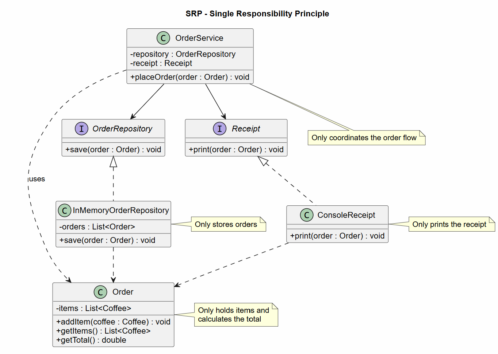
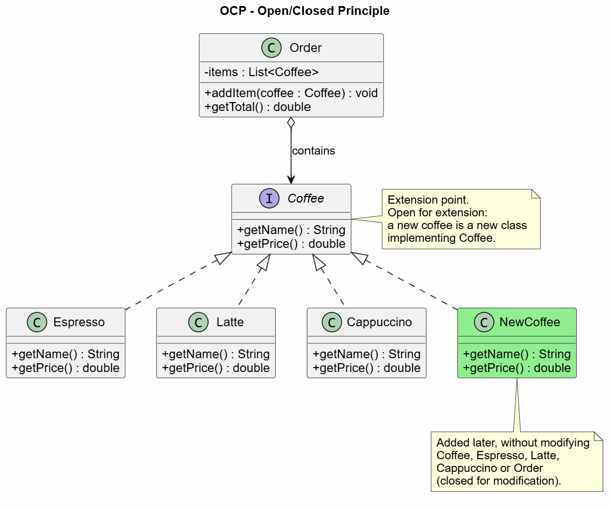
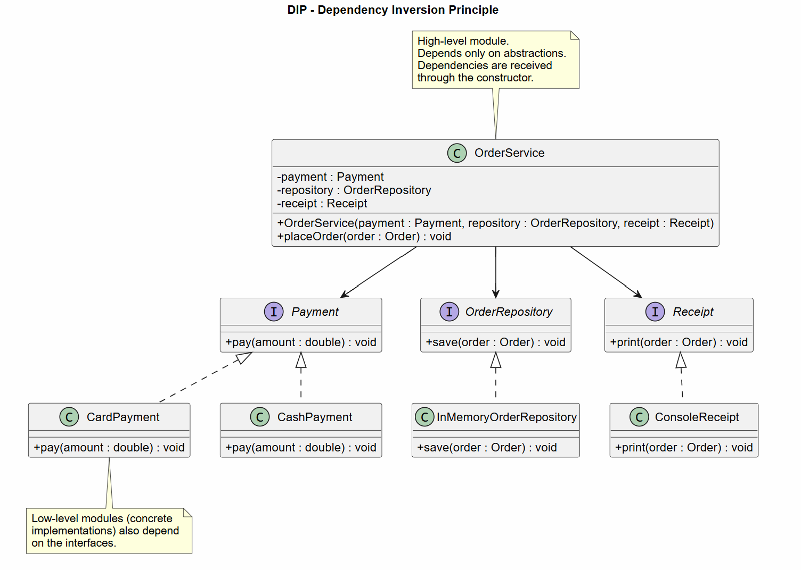
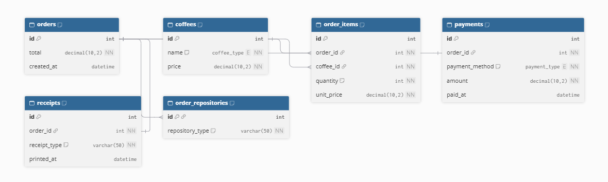

# Lab 1 - Coffee Order Application

## Description

This project is a small Java console application for placing coffee orders.
Users can add Espresso, Latte, or Cappuccino products, choose card or cash
payment, save the order in memory, and print a receipt in the console.

The project demonstrates three SOLID principles:

- **Single Responsibility Principle (SRP)** - each class has one focused
  responsibility.
- **Open/Closed Principle (OCP)** - new coffee and payment implementations can
  be added without modifying the existing order workflow.
- **Dependency Inversion Principle (DIP)** - `OrderService` depends on
  interfaces instead of concrete implementations.

## SOLID Principles

### 1. Single Responsibility Principle (SRP)

`Order` manages coffee items and calculates the order total. Saving orders,
printing receipts, and coordinating the workflow are handled by separate
classes.

```java
public class Order {
    private final List<Coffee> items = new ArrayList<>();

    public void addItem(Coffee coffee) {
        items.add(coffee);
    }

    public double getTotal() {
        double total = 0;
        for (Coffee coffee : items) {
            total += coffee.getPrice();
        }
        return total;
    }
}
```



The diagram shows the separate responsibilities of `Order`,
`InMemoryOrderRepository`, `ConsoleReceipt`, and `OrderService`.


### 2. Open/Closed Principle (OCP)

The `Coffee` interface allows new coffee products to be added without
changing `Order` or `OrderService`.

```java
public interface Coffee {
    String getName();
    double getPrice();
}

public class Latte implements Coffee {
    @Override
    public String getName() {
        return "Latte";
    }

    @Override
    public double getPrice() {
        return 40.0;
    }
}
```



The diagram shows that `Espresso`, `Latte`, `Cappuccino`, and future coffee
types implement `Coffee`. Existing order-processing classes remain unchanged.


### 3. Dependency Inversion Principle (DIP)

`OrderService` receives abstractions through its constructor instead of
creating concrete payment, repository, or receipt objects.

```java
public class OrderService {
    private final Payment payment;
    private final OrderRepository repository;
    private final Receipt receipt;

    public OrderService(
            Payment payment,
            OrderRepository repository,
            Receipt receipt) {
        this.payment = payment;
        this.repository = repository;
        this.receipt = receipt;
    }

    public void placeOrder(Order order) {
        payment.pay(order.getTotal());
        repository.save(order);
        receipt.print(order);
    }
}
```



The diagram shows that `OrderService` uses the `Payment`,
`OrderRepository`, and `Receipt` interfaces. Their concrete implementations
can be replaced independently.

#### DIP PlantUML



## Features

- Add Espresso, Latte, or Cappuccino to an order.
- Add more than one product to the same order.
- Calculate the total price in MDL.
- Pay by card or cash.
- Save the order in memory.
- Print a receipt in the console.
- Show messages for invalid menu options.

## Project Structure

- `Main.java` - starts the application and reads user input.
- `Coffee.java` - defines the coffee interface.
- `Espresso.java` - implements the Espresso product.
- `Latte.java` - implements the Latte product.
- `Cappuccino.java` - implements the Cappuccino product.
- `Order.java` - stores products and calculates the order total.
- `Payment.java` - defines the payment interface.
- `CardPayment.java` - implements card payments.
- `CashPayment.java` - implements cash payments.
- `OrderRepository.java` - defines the order storage interface.
- `InMemoryOrderRepository.java` - stores orders in memory.
- `Receipt.java` - defines the receipt interface.
- `ConsoleReceipt.java` - prints receipts to the console.
- `OrderService.java` - coordinates payment, storage, and receipt printing.
- `pom.xml` - Maven project configuration.

## How to Use

When the application starts, choose a product:

```text
1. Espresso - 25.0 MDL
2. Latte - 40.0 MDL
3. Cappuccino - 38.0 MDL
0. Finish order
```

Enter `1`, `2`, or `3` to add a product. Enter `0` when the order is ready.
After that, choose a payment method:

```text
1. Card
2. Cash
```

The application then processes the payment, saves the order, and prints the
receipt.

## Example

```text
Product added. Add more products or choose 0 to finish.
Choose a payment method:
1. Card
2. Cash
Card payment: 65.0 MDL
Order saved. Total orders: 1
----- RECEIPT -----
Espresso - 25.0
Latte - 40.0
TOTAL: 65.0
------------------
```

## Notes

Orders are saved only in memory. They are lost when the application stops.
