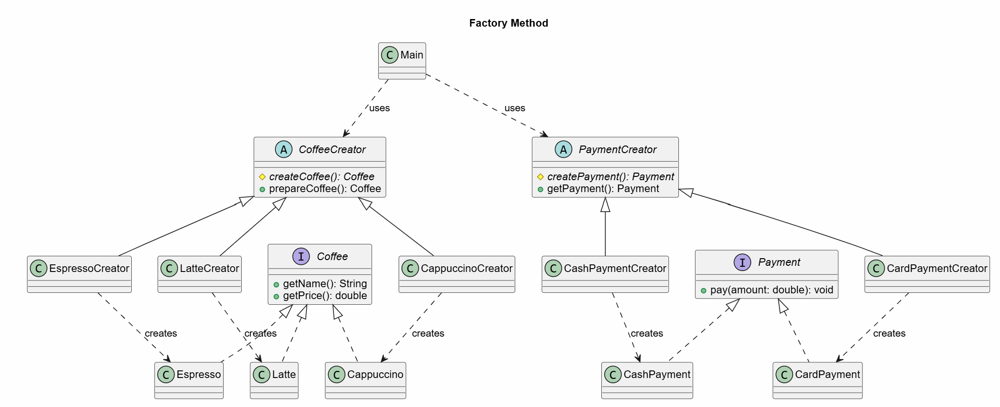
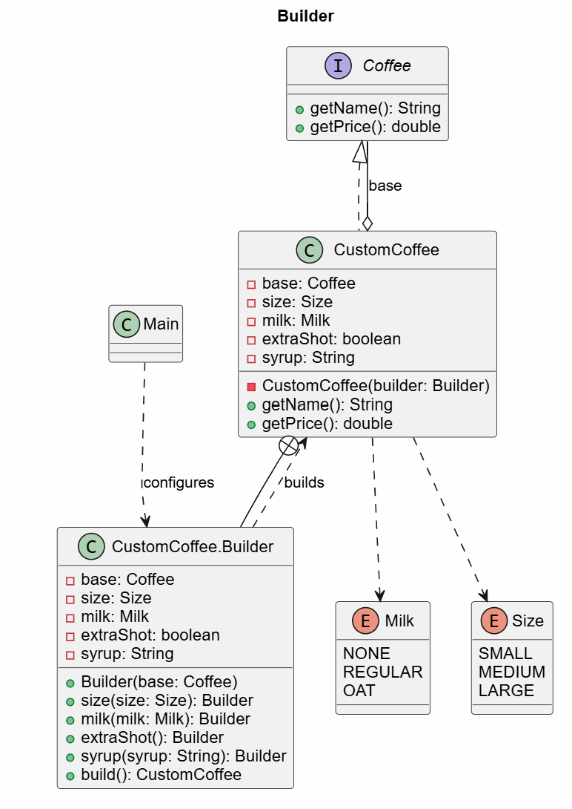
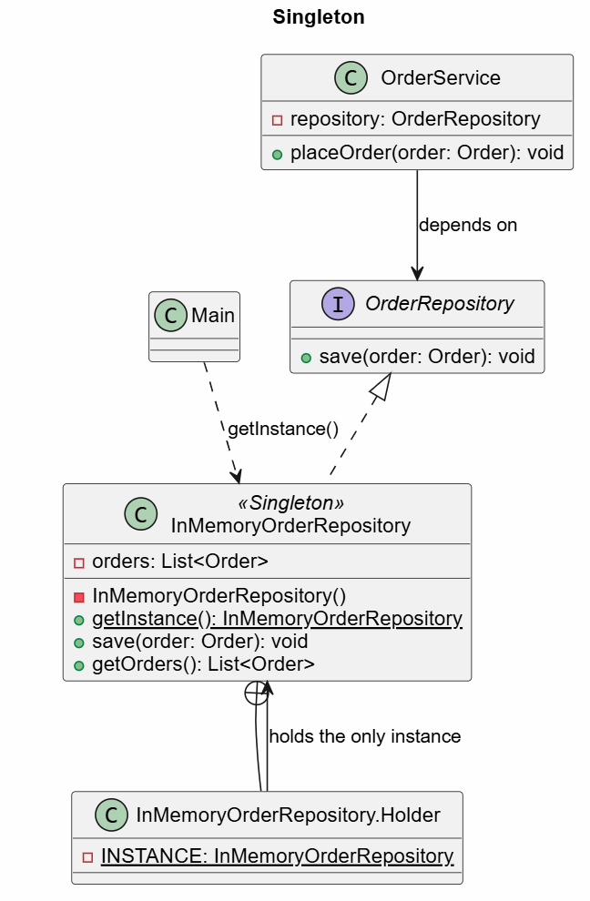

# Lab 2 - Creational Design Patterns

## Description

This project continues the coffee order application from Lab 1. The
application still lets users order Espresso, Latte, or Cappuccino, pay by card
or cash, save the order in memory, and print a receipt. It now also supports
custom coffees and placing several orders in one session.

The SOLID structure from Lab 1 is kept, and three creational design patterns
are added:

- **Factory Method** - coffee and payment objects are created by creator
  classes instead of `new` calls in `Main`.
- **Builder** - a custom coffee (size, milk, extra shot, syrup) is built step
  by step.
- **Singleton** - all orders are stored in one shared repository instance.

## Design Patterns

### 1. Factory Method

**Purpose:** define a method for creating an object, and let subclasses decide
which concrete class is created. Client code depends only on the product
abstraction.

In Lab 1, `Main` created products directly with `new Espresso()`,
`new Latte()`, `new CardPayment()`, and so on. Now `CoffeeCreator` declares the
factory method `createCoffee()`, and each concrete creator returns one coffee
type. `PaymentCreator` does the same for payments.

```java
public abstract class CoffeeCreator {
    protected abstract Coffee createCoffee();

    public Coffee prepareCoffee() {
        Coffee coffee = createCoffee();
        System.out.println("Preparing " + coffee.getName() + "...");
        return coffee;
    }
}

public class LatteCreator extends CoffeeCreator {
    @Override
    protected Coffee createCoffee() {
        return new Latte();
    }
}
```

`Main` keeps a menu of creators. Adding a new coffee means adding a `Coffee`
class, a creator, and one menu entry. The order workflow does not change, so
this pattern also supports the Open/Closed Principle from Lab 1.

```java
COFFEE_MENU.put("1", new EspressoCreator());
COFFEE_MENU.put("2", new LatteCreator());
COFFEE_MENU.put("3", new CappuccinoCreator());
...
order.addItem(COFFEE_MENU.get(option).prepareCoffee());
```



The diagram shows that `Main` uses only the creators. Each concrete creator
decides which `Coffee` or `Payment` implementation is created.

### 2. Builder

**Purpose:** construct a complex object step by step, with optional
parameters, without a constructor that takes many arguments.

A custom coffee has a base coffee and several optional settings. Each setting
changes the name and the price. `CustomCoffee.Builder` provides one method per
setting and returns itself, so calls can be chained. `build()` creates an
immutable `CustomCoffee`.

```java
Coffee coffee = new CustomCoffee.Builder(new Latte())
        .size(CustomCoffee.Size.LARGE)
        .milk(CustomCoffee.Milk.OAT)
        .extraShot()
        .syrup("vanilla")
        .build();
// Latte (large, oat milk, extra shot, vanilla syrup) - 73.0 MDL
```

`CustomCoffee` implements `Coffee`, so `Order`, `ConsoleReceipt`, and
`OrderService` work with it without any changes. The base coffee comes from a
creator, so the Builder and the Factory Method are used together.

| Option      | Extra price |
|-------------|-------------|
| Small       | +0 MDL      |
| Medium      | +5 MDL      |
| Large       | +10 MDL     |
| Regular milk| +3 MDL      |
| Oat milk    | +8 MDL      |
| Extra shot  | +10 MDL     |
| Syrup       | +5 MDL      |



The diagram shows that `CustomCoffee.Builder` collects the optional settings
and creates an immutable `CustomCoffee`, which is also a `Coffee`.

### 3. Singleton

**Purpose:** make sure a class has only one instance and provide one global
access point to it.

All orders must go to the same storage. If two `InMemoryOrderRepository`
objects existed, the orders would be split between two lists. The constructor
is now private, and the only instance is returned by `getInstance()`.

```java
public class InMemoryOrderRepository implements OrderRepository {
    private final List<Order> orders = new ArrayList<>();

    private InMemoryOrderRepository() {
    }

    private static class Holder {
        private static final InMemoryOrderRepository INSTANCE = new InMemoryOrderRepository();
    }

    public static InMemoryOrderRepository getInstance() {
        return Holder.INSTANCE;
    }
}
```

The Holder idiom creates the instance on the first call to `getInstance()`
(lazy initialization). The JVM loads classes in a thread-safe way, so no
`synchronized` is needed.

The repository still implements `OrderRepository`. `OrderService` receives the
interface through its constructor, as in Lab 1, so the Dependency Inversion
Principle is kept. Only `Main` knows about the Singleton.



The diagram shows that the only `InMemoryOrderRepository` instance is held by
`Holder`, while `OrderService` still depends on the `OrderRepository`
interface.

## Features

- Add Espresso, Latte, or Cappuccino to an order.
- Build a custom coffee with size, milk, extra shot, and syrup.
- Add more than one product to the same order.
- Calculate the total price in MDL.
- Pay by card or cash.
- Place several orders in one session. All orders are saved in the same
  repository.
- Print a receipt in the console.
- Show messages for invalid menu options.

## Project Structure

Classes from Lab 1:

- `Coffee.java`, `Espresso.java`, `Latte.java`, `Cappuccino.java` - coffee
  products.
- `Order.java` - stores products and calculates the order total.
- `Payment.java`, `CardPayment.java`, `CashPayment.java` - payment methods.
- `OrderRepository.java` - defines the order storage interface.
- `Receipt.java`, `ConsoleReceipt.java` - receipt printing.
- `OrderService.java` - coordinates payment, storage, and receipt printing.

New or changed in Lab 2:

- `CoffeeCreator.java` - Factory Method creator for coffees.
- `EspressoCreator.java`, `LatteCreator.java`, `CappuccinoCreator.java` -
  concrete coffee creators.
- `PaymentCreator.java` - Factory Method creator for payments.
- `CardPaymentCreator.java`, `CashPaymentCreator.java` - concrete payment
  creators.
- `CustomCoffee.java` - custom coffee and its `Builder`.
- `InMemoryOrderRepository.java` - now a Singleton.
- `Main.java` - uses creators, the builder, and the singleton repository.
- `pom.xml` - Maven project configuration.

## How to Use

When the application starts, choose a product:

```text
1. Espresso - 25.0 MDL
2. Latte - 40.0 MDL
3. Cappuccino - 38.0 MDL
4. Custom coffee
0. Finish order
```

Option `4` asks for a base coffee, size, milk, extra shot, and syrup. Enter `0`
when the order is ready, then choose card or cash. After the receipt is
printed, answer `y` to place another order or `n` to exit.

## Example

```text
Option: 4
Choose the base coffee:
Option: 2
Preparing Latte...
Size: 1. Small (+0)  2. Medium (+5)  3. Large (+10)
Option: 3
Milk: 1. None (+0)  2. Regular (+3)  3. Oat (+8)
Option: 3
Extra shot (+10)? (y/n): y
Syrup (+5), leave empty for none: vanilla
Built: Latte (large, oat milk, extra shot, vanilla syrup) - 73.0 MDL
Product added. Add more products or choose 0 to finish.
Option: 0
Choose a payment method:
1. Card
2. Cash
Option: 2
Cash payment: 73.0 MDL
Order saved. Total orders: 1
----- RECEIPT -----
Latte (large, oat milk, extra shot, vanilla syrup) - 73.0
TOTAL: 73.0
------------------
Place another order? (y/n): n
Orders placed today: 1
```

## Notes

Orders are saved only in memory. They are lost when the application stops.
