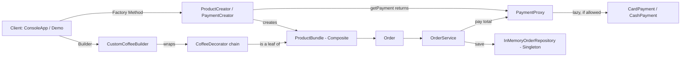
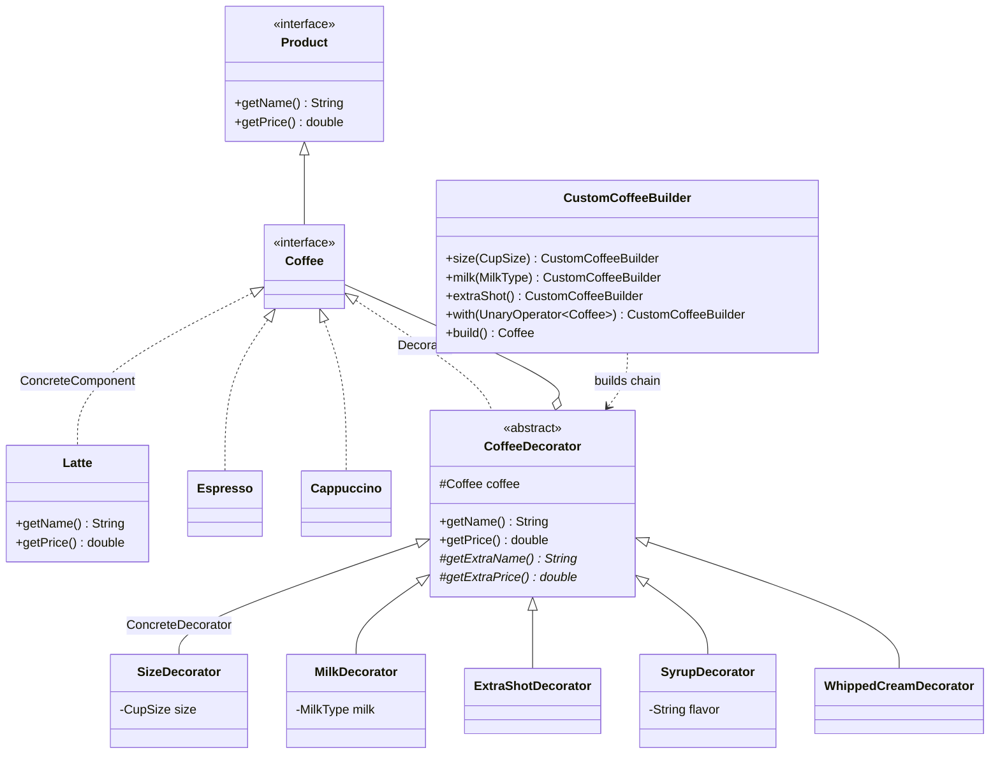
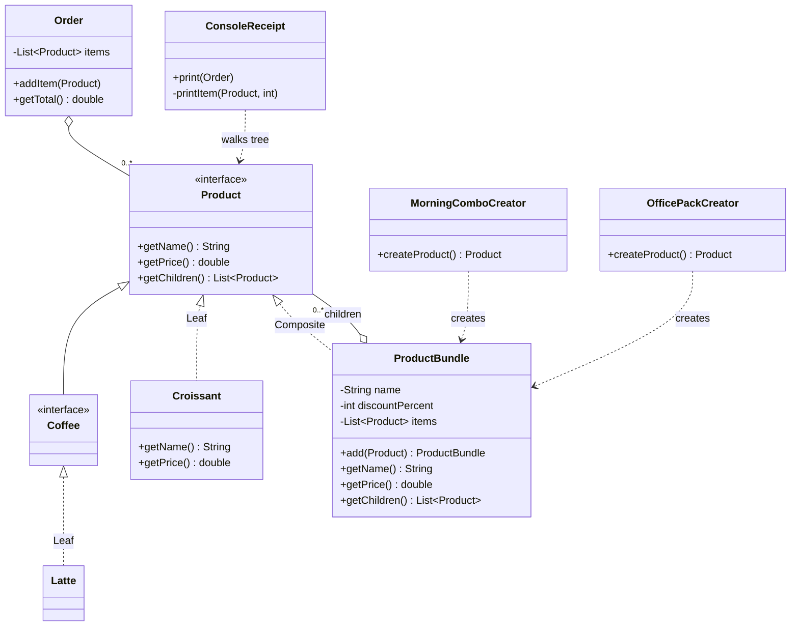
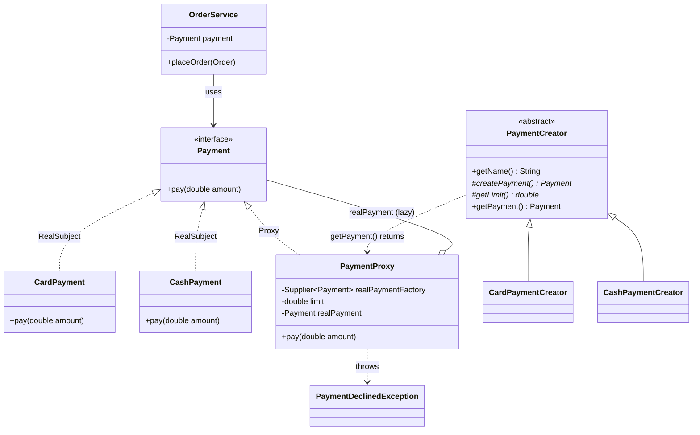

# Laboratory Work No. 3 - Structural Design Patterns

## 1. Domain description

The application is a console coffee shop. A customer adds products to an
order: plain coffees (Espresso, Latte, Cappuccino), a Croissant, ready-made
bundles (Morning combo, Office pack) and custom coffees with add-ons. The
order is paid by card or cash, saved in memory and printed as a receipt.

The project continues the creational lab: products and payments are still
created by **Factory Method** creators, custom coffees by a **Builder**, and
orders are saved in a **Singleton** repository. Lab 3 adds three structural
patterns, each solving a problem the Lab 2 code had:

| Problem in Lab 2                                                                                 | Pattern       |
|--------------------------------------------------------------------------------------------------|---------------|
| `CustomCoffee` held every option as a field; a new add-on meant editing the class, and an add-on could not be applied twice. | **Decorator** |
| An order was a flat list of coffees; there was no way to sell a combo, let alone a combo inside a pack. | **Composite** |
| `OrderService` called the real payment directly; there was no place to enforce limits, and the card terminal was "connected" even for payments that would be refused. | **Proxy**     |

### Pattern interaction

All patterns sit on one execution path (see `Demo.allTogether()` and
`PatternInteractionTest`):



`OrderService` only sees `Order`, `Payment`, `OrderRepository` and `Receipt`.
It does not know the order contains decorators and bundles, or that the
payment is a proxy.

---

## 2. Patterns

### 2.1 Decorator

**Intent:** add responsibilities to an object at runtime by wrapping it, in any
combination.

**Why here:** a coffee can get any combination of add-ons, including the same
one twice (double shot). With subclasses this would explode
(`LatteWithOatMilkAndVanilla`...), and with one big class (Lab 2
`CustomCoffee`) every new add-on means editing it. Each add-on is now one small
class that wraps any `Coffee`.

#### Class diagram



Roles: **Component** `Coffee`, **ConcreteComponent** `Espresso`/`Latte`/`Cappuccino`,
**Decorator** `CoffeeDecorator`, **ConcreteDecorators** `SizeDecorator`,
`MilkDecorator`, `ExtraShotDecorator`, `SyrupDecorator`, `WhippedCreamDecorator`.

#### Code snippet

[CoffeeDecorator.java](src/main/java/coffeeshop/structural/decorator/CoffeeDecorator.java#L12-L32)

```java
public abstract class CoffeeDecorator implements Coffee {
    protected final Coffee coffee;

    protected CoffeeDecorator(Coffee coffee) {
        this.coffee = Objects.requireNonNull(coffee, "A decorator needs a coffee to wrap.");
    }

    @Override
    public String getName() {
        return coffee.getName() + " + " + getExtraName();
    }

    @Override
    public double getPrice() {
        return coffee.getPrice() + getExtraPrice();
    }

    protected abstract String getExtraName();
    protected abstract double getExtraPrice();
}
```

The decorator both **is** a `Coffee` and **has** a `Coffee`. Every call is
forwarded to the wrapped object and the add-on's part is added, so a decorator
can wrap a plain coffee or another decorator, and the client cannot tell the
difference.

The Lab 2 Builder now produces decorator chains
([CustomCoffeeBuilder.java](src/main/java/coffeeshop/creational/builder/CustomCoffeeBuilder.java)).
Its `with(UnaryOperator<Coffee>)` step accepts any decorator, so a new add-on
does not require changing the builder.

#### Unit tests - [DecoratorTest.java](src/test/java/coffeeshop/DecoratorTest.java)

| Test                                              | What it proves                                                          |
|---------------------------------------------------|-------------------------------------------------------------------------|
| `decoratorAddsItsPartOnTopOfTheWrappedCoffee`     | A decorator delegates to the wrapped coffee and adds its name and price. |
| `decoratorsStackedInAnyOrderGiveTheSamePrice`     | Three different stacking orders of the same add-ons give the same price and all add-on names. |
| `sameDecoratorCanBeStackedMoreThanOnce`           | Double shot = two `ExtraShotDecorator`s, impossible with the old boolean field. |
| `decoratedCoffeeIsUsedByClientCodeLikeAnyCoffee`  | `Order` sums a decorated coffee without knowing it is decorated.        |
| `builderAssemblesTheSameChainAsManualDecoration`  | Builder + Decorator give the same 73 MDL as the Lab 2 `CustomCoffee`.  |

---

### 2.2 Composite

**Intent:** treat individual objects and groups of objects uniformly through
one interface.

**Why here:** the shop sells combos, and a pack can contain a combo
(Office pack contains Morning combo). The order, the receipt and the total
must work the same whether an item is a single Latte or a nested bundle.

#### Class diagram



Roles: **Component** `Product`, **Leaf** `Espresso`/`Latte`/`Cappuccino`/`Croissant`
(and every decorated coffee), **Composite** `ProductBundle`, **Clients**
`Order` and `ConsoleReceipt`.

#### Code snippet

[ProductBundle.java](src/main/java/coffeeshop/structural/composite/ProductBundle.java#L32-L58)

```java
public ProductBundle add(Product product) {
    Objects.requireNonNull(product, "Product cannot be null.");
    if (product == this || contains(product, this)) {
        throw new IllegalArgumentException("A bundle cannot contain itself.");
    }
    items.add(product);
    return this;
}

@Override
public double getPrice() {
    double sum = 0;
    for (Product item : items) {
        sum += item.getPrice(); // leaf or nested bundle, same call
    }
    return sum * (100 - discountPercent) / 100.0;
}

@Override
public List<Product> getChildren() {
    return Collections.unmodifiableList(items);
}
```

`getPrice()` asks each child for its price without knowing whether it is a
leaf or another bundle, so nesting works to any depth. Child management
(`add`) exists only on the composite (safe Composite), while `getChildren()`
is on `Product` with an empty default for leaves, so
[ConsoleReceipt](src/main/java/coffeeshop/service/ConsoleReceipt.java#L20-L25)
prints the whole tree without `instanceof`.

#### Unit tests - [CompositeTest.java](src/test/java/coffeeshop/CompositeTest.java)

| Test                                          | What it proves                                                              |
|-----------------------------------------------|-----------------------------------------------------------------------------|
| `leafAndBundleAreUsedThroughTheSameInterface` | A `Latte` and a bundle sit in one `List<Product>` and are summed by the same code. |
| `nestedBundlesComputePriceRecursively`        | Office pack (with nested Morning combo) = (40 + 50 + 38 + 49.5) * 0.8 = 142; leaf count via one recursive helper. |
| `bundleDiscountAppliesToAllChildren`          | The bundle discount is applied to the sum of all children.                 |
| `bundleCannotContainItself`                   | Direct and indirect cycles are rejected.                                    |

---

### 2.3 Proxy

**Intent:** control access to an object through a stand-in with the same
interface.

**Why here:** each payment method has a limit (cash: 300 MDL, the counter
does not keep enough change; card: 1000 MDL). The check must happen before
the real payment is touched, and creating the real payment (connecting to
the card terminal, opening the cash drawer) should only happen when a payment
is actually going to go through. `PaymentProxy` is both a **protection proxy**
and a **virtual proxy**.

#### Class diagram



Roles: **Subject** `Payment`, **RealSubject** `CardPayment`/`CashPayment`,
**Proxy** `PaymentProxy`, **Client** `OrderService`.

#### Code snippet

[PaymentProxy.java](src/main/java/coffeeshop/structural/proxy/PaymentProxy.java#L28-L41)

```java
@Override
public void pay(double amount) {
    if (amount <= 0) {
        throw new PaymentDeclinedException("Amount must be positive, got " + amount + " MDL.");
    }
    if (amount > limit) {
        throw new PaymentDeclinedException(String.format(
                "%.2f MDL is above the %.2f MDL limit for this payment method.", amount, limit));
    }
    if (realPayment == null) {
        realPayment = realPaymentFactory.get();
    }
    System.out.printf("[PaymentProxy] Authorized %.2f MDL (limit %.2f MDL).%n", amount, limit);
    realPayment.pay(amount);
}
```

The proxy implements the same `Payment` interface, checks the amount, and
only then creates (once) and calls the real payment with the **unchanged**
amount. The Factory Method from Lab 2 hands out the proxy
([PaymentCreator.java](src/main/java/coffeeshop/creational/factory/PaymentCreator.java#L17-L19)),
so no client ever holds a real payment:

```java
public Payment getPayment() {
    return new PaymentProxy(this::createPayment, getLimit());
}
```

#### Unit tests - [ProxyTest.java](src/test/java/coffeeshop/ProxyTest.java)

| Test                                                          | What it proves                                                      |
|---------------------------------------------------------------|---------------------------------------------------------------------|
| `authorizedPaymentPassesThroughUnchanged`                     | Allowed amounts (including exactly the limit) reach the real payment unchanged. |
| `paymentAboveLimitIsBlockedAndRealPaymentIsNeverCreated`      | Over-limit payment throws, and the real payment is never even created. |
| `nonPositiveAmountIsBlocked`                                  | 0 and negative amounts are blocked.                                |
| `realPaymentIsCreatedLazilyAndOnlyOnce`                       | Virtual proxy: nothing is created before the first payment, then one instance is reused. |
| `factoryMethodHandsOutAProxyInsteadOfTheRealPayment`          | `CashPaymentCreator.getPayment()` returns a proxy enforcing the 300 MDL cash limit. |

---

### 2.4 Pattern interaction tests - [PatternInteractionTest.java](src/test/java/coffeeshop/PatternInteractionTest.java)

| Test                                              | What it proves                                                              |
|---------------------------------------------------|-----------------------------------------------------------------------------|
| `decoratedCoffeeInsideBundleIsPaidThroughProxy`   | Builder → Decorator → Composite → `OrderService` → Proxy: the real payment receives exactly (58 + 142) * 0.9 = 180 MDL; the order is saved and printed once. |
| `declinedPaymentStopsTheWorkflow`                 | When the proxy declines, the order is neither paid, saved, nor printed.    |

Repository and receipt are replaced by lambdas (stubs), which is possible
because `OrderService` depends only on interfaces.

### 2.5 Test run

```text
$ mvn test
[INFO] -------------------------------------------------------
[INFO]  T E S T S
[INFO] -------------------------------------------------------
[INFO] Running coffeeshop.CompositeTest
[INFO] Tests run: 4, Failures: 0, Errors: 0, Skipped: 0 -- in coffeeshop.CompositeTest
[INFO] Running coffeeshop.PatternInteractionTest
[INFO] Tests run: 2, Failures: 0, Errors: 0, Skipped: 0 -- in coffeeshop.PatternInteractionTest
[INFO] Running coffeeshop.ProxyTest
[INFO] Tests run: 5, Failures: 0, Errors: 0, Skipped: 0 -- in coffeeshop.ProxyTest
[INFO] Running coffeeshop.DecoratorTest
[INFO] Tests run: 5, Failures: 0, Errors: 0, Skipped: 0 -- in coffeeshop.DecoratorTest
[INFO]
[INFO] Results:
[INFO]
[INFO] Tests run: 16, Failures: 0, Errors: 0, Skipped: 0
[INFO]
[INFO] BUILD SUCCESS
```

### 2.6 Demo output (`mvn -q compile exec:java -Dexec.args=demo`, last part)

```text
=== 4. ALL TOGETHER - Factory -> Builder -> Decorator -> Composite -> Proxy -> Singleton ===
Preparing Latte...
Preparing Office pack (-20%)...
Preparing Morning combo (-10%)...
Connecting to the card terminal...
[PaymentProxy] Authorized 253.75 MDL (limit 1000.00 MDL).
Card payment: 253.75 MDL
Order saved. Total orders: 1
----- RECEIPT -----
Team box (-5%) - 204.25
    Latte + large + oat milk + extra shot + vanilla syrup - 73.00
    Office pack (-20%) - 142.00
        Latte - 40.00
        Latte + large - 50.00
        Cappuccino - 38.00
        Morning combo (-10%) - 49.50
            Espresso - 25.00
            Croissant - 30.00
Morning combo (-10%) - 49.50
    Espresso - 25.00
    Croissant - 30.00
TOTAL: 253.75 MDL
-------------------
```

---

## 3. Open for extension

| New requirement                 | What is added                                                        | What is changed |
|---------------------------------|----------------------------------------------------------------------|-----------------|
| New add-on (e.g. cinnamon)      | `CinnamonDecorator extends CoffeeDecorator`                          | One line in `Menu` to show it in the console |
| New bundle (e.g. Student deal)  | `StudentDealCreator extends ProductCreator<Product>` building a `ProductBundle` | One line in `Menu` |
| New payment (e.g. mobile)       | `MobilePayment implements Payment`, `MobilePaymentCreator` with its limit | One line in `Menu`. It is proxied automatically. |

`Menu` is the composition root of the console client. Domain classes,
patterns, `OrderService`, `Order` and `ConsoleReceipt` stay unchanged.
`WhippedCreamDecorator` was added this way.

## 4. Conclusions

**What was harder than expected:**

- Fitting the Lab 2 Builder together with the Decorator. The old
  `CustomCoffee` held every option as a field. Turning `build()` into
  "wrap the base in a chain of decorators" kept the Builder's API but removed
  the class that had to change for every new add-on. The generic `with(...)`
  step was needed so the builder itself stays closed for modification.
- Printing nested bundles without `instanceof`. A purely "safe" Composite
  (child methods only on the composite) forces the receipt to check types.
  The compromise was a read-only `getChildren()` on `Product` with an empty
  default, while `add()` stays only on `ProductBundle`.
- Choosing what the proxy controls. Logging alone would be a decorator in
  disguise; the limit check and lazy creation give the proxy a real
  access-control job.

**What I would design differently:**

- Use `BigDecimal` for money. `double` works for these prices but can produce
  rounding errors with other discounts.
- Load the menu (products, prices, bundle contents) from configuration
  instead of the `Menu` class, so that a new bundle needs no code at all.
- Let a declined payment return a result object instead of throwing, so the
  console flow does not rely on exceptions for a normal business case.
