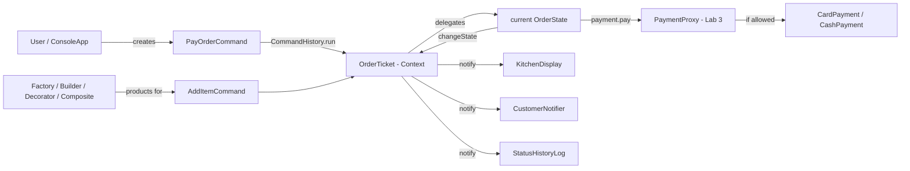
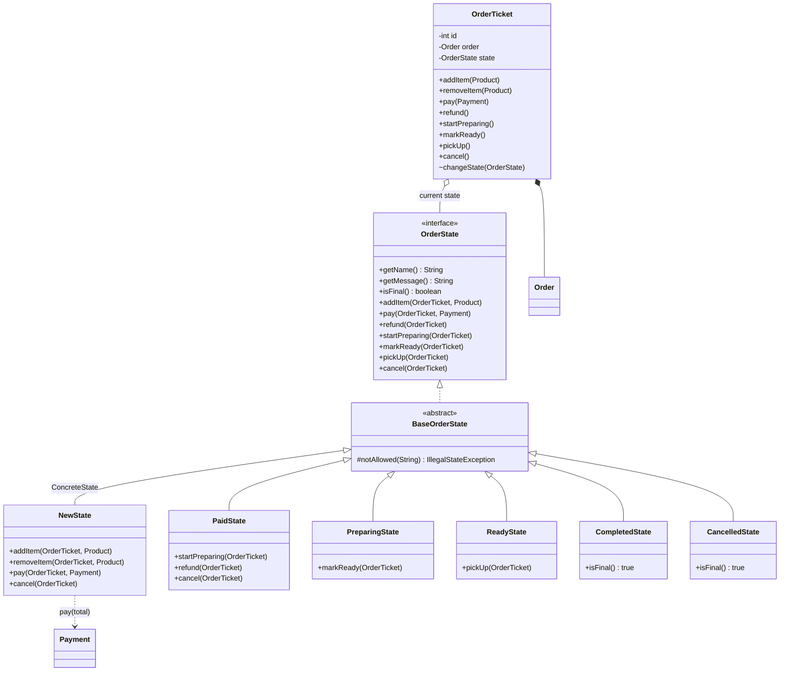
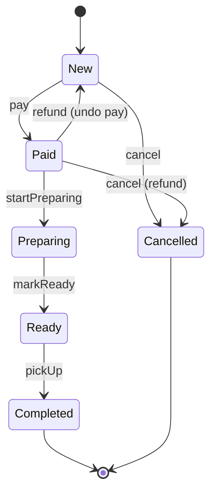
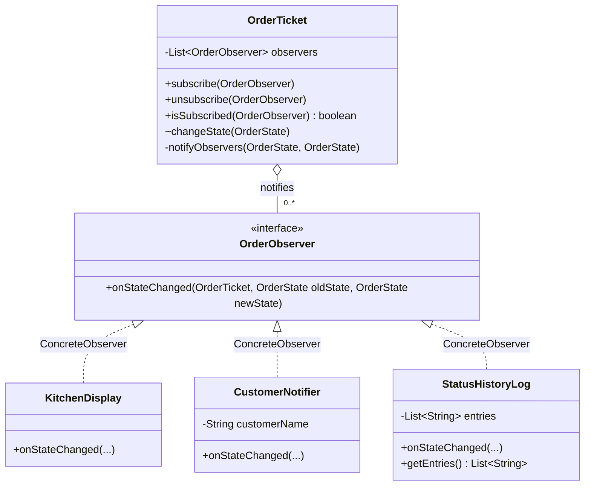
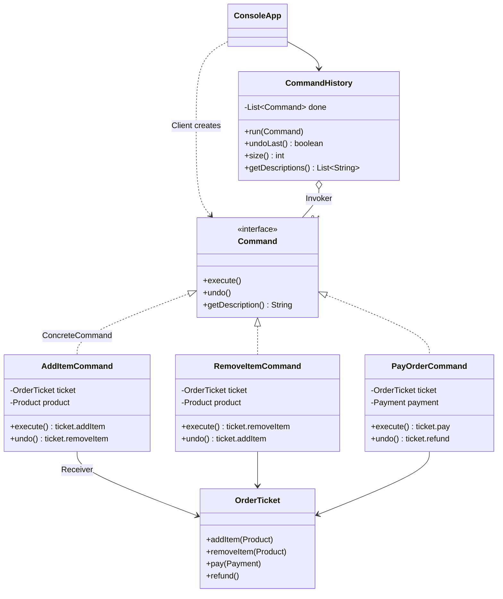

# Report - Laboratory Work No. 4 - Behavioral Design Patterns

## 1. Domain description

The application is a console coffee shop. A customer adds products to an
order (coffees, a croissant, bundles like Morning combo / Office pack and
custom coffees with add-ons), pays by card or cash, and then the order goes
through the kitchen until the customer picks it up.

The project continues the previous labs: products and payments are created by
**Factory Method** creators, custom coffees by a **Builder** that wraps
**Decorators**, combos are **Composites**, payments go through a
**PaymentProxy** with limits, and finished orders are saved in a
**Singleton** repository.

Lab 4 adds the life of an order after it is created. Before, an `Order` was
just a list of products that was paid and saved in one step. Now:

| Problem in Lab 3                                                                                              | Pattern      |
|---------------------------------------------------------------------------------------------------------------|--------------|
| An order had no status. Nothing stopped adding products after paying or picking up an order that was never paid. Doing it with `if (status == ...)` everywhere would grow with every new status. | **State**    |
| The kitchen and the customer had to be told when the order changes. Calling them directly from the order would tie it to every screen / notification type. | **Observer** |
| The user could not undo a mistake (wrong product, wrong payment method). A plain method call leaves nothing to undo. | **Command**  |

### Pattern interaction

One user action passes through several patterns:



Example (see `Demo.allTogether()` and `BehavioralInteractionTest`): the user
runs a `PayOrderCommand`; the ticket passes it to `NewState`; the state asks
the `PaymentProxy` to pay; if the proxy declines (over the cash limit) the
state stays `New` and no observer is notified; if it pays, the state becomes
`Paid` and all observers are told. Undo of the command is a refund, which is
again checked by the state (allowed in `Paid`, rejected in `Preparing`).

The client code works only with interfaces: `Command`, `OrderState`,
`OrderObserver`, `Payment`, `Product`.

---

## 2. Patterns

### 2.1 State

**Intent:** change an object's behavior when its internal state changes.

**Why here:** the same action means different things depending on the order
status. `addItem` works in `New` but must be rejected in `Paid`; `cancel`
works in `New` (no refund) and in `Paid` (with refund) but not in
`Preparing`. Each status is a class, so there is no `switch` on a status
enum and the rules for one status are in one place.

#### Class diagram



Roles: **Context** `OrderTicket`, **State** `OrderState`,
**ConcreteStates** `NewState`, `PaidState`, `PreparingState`, `ReadyState`,
`CompletedState`, `CancelledState`.

Transitions:



#### Code snippet

[OrderTicket.java](src/main/java/coffeeshop/behavioral/state/OrderTicket.java#L50-L80) and
[NewState.java](src/main/java/coffeeshop/behavioral/state/NewState.java#L36-L52)

```java
// OrderTicket (Context): no if/switch, every action goes to the current state
public void addItem(Product product) {
    state.addItem(this, product);
}

public void pay(Payment payment) {
    state.pay(this, payment);
}

// NewState (ConcreteState): decides what happens and which state is next
@Override
public void pay(OrderTicket ticket, Payment payment) {
    if (ticket.getOrder().isEmpty()) {
        throw new IllegalStateException("Cannot pay: the order has no products.");
    }
    payment.pay(ticket.getOrder().getTotal());
    ticket.changeState(new PaidState());
}

// BaseOrderState: everything a state does not override is forbidden
@Override
public void pickUp(OrderTicket ticket) {
    throw notAllowed("pick up");
}
```

The ticket only forwards the call to `state`. The transition is written
inside the state (`ticket.changeState(new PaidState())`), and `changeState`
is package-private, so client code cannot jump to any state it wants.
If `payment.pay` throws (declined by the proxy), `changeState` is never
reached and the order stays `New`.

#### Unit tests - [StateTest.java](src/test/java/coffeeshop/StateTest.java)

| Test                                                     | What it proves                                                          |
|----------------------------------------------------------|-------------------------------------------------------------------------|
| `newTicketStartsInNewState`                              | A ticket starts in `New` and it is not final.                           |
| `validTransitionsGoFromNewToCompleted`                   | pay -> startPreparing -> markReady -> pickUp moves through every state. |
| `forbiddenTransitionsAreRejectedAndStateDoesNotChange`   | pickUp in `New`, addItem in `Paid`, cancel in `Preparing` throw and the state stays the same. |
| `finalStatesAllowNothing`                                | After `cancel` no action works anymore.                                 |
| `emptyOrderCannotBePaid`                                 | `New` refuses to pay an empty order and the payment is never called.    |

---

### 2.2 Observer

**Intent:** notify dependent objects automatically when an object's state changes.

**Why here:** when the order status changes, several independent parts care:
the kitchen screen, the customer (SMS), a history log. The ticket must not
know about them, and the customer must be able to turn notifications on and
off while the app runs.

#### Class diagram



Roles: **Subject** `OrderTicket`, **Observer** `OrderObserver`,
**ConcreteObservers** `KitchenDisplay`, `CustomerNotifier`, `StatusHistoryLog`.

#### Code snippet

[OrderTicket.java](src/main/java/coffeeshop/behavioral/state/OrderTicket.java#L84-L119)

```java
public void subscribe(OrderObserver observer) {
    if (observer == null) {
        throw new IllegalArgumentException("Observer cannot be null.");
    }
    if (!observers.contains(observer)) {
        observers.add(observer);
    }
}

public void unsubscribe(OrderObserver observer) {
    observers.remove(observer);
}

void changeState(OrderState newState) {
    OrderState oldState = this.state;
    this.state = newState;
    notifyObservers(oldState, newState);
}

private void notifyObservers(OrderState oldState, OrderState newState) {
    List<OrderObserver> copy = new ArrayList<>(observers);
    for (OrderObserver observer : copy) {
        observer.onStateChanged(this, oldState, newState);
    }
}
```

The subject keeps a list of the `OrderObserver` interface only, and the
notify loop runs after every state change. Observers just read the ticket and
never change its state, so there is no update loop. The loop walks over a copy,
so an observer may unsubscribe while being notified.

Runtime behavior: in the console the `n` key calls `subscribe` /
`unsubscribe` on the `CustomerNotifier`, so SMS messages stop and start while
the program runs.

#### Unit tests - [ObserverTest.java](src/test/java/coffeeshop/ObserverTest.java)

| Test                                          | What it proves                                                    |
|-----------------------------------------------|-------------------------------------------------------------------|
| `allSubscribedObserversAreNotified`           | Two observers receive the same changes in the same order.         |
| `unsubscribedObserverIsNotNotifiedAnymore`    | After `unsubscribe` an observer gets nothing; the other one still does. |
| `sameObserverSubscribedTwiceIsNotifiedOnce`   | Subscribing twice does not send duplicate notifications.          |
| `rejectedActionDoesNotNotifyObservers`        | A forbidden transition does not produce a notification.           |

---

### 2.3 Command

**Intent:** turn a request into an object so it can be queued, logged or undone.

**Why here:** the customer changes their mind: removes the wrong coffee,
or pays by cash and then wants card. Each action is an object that knows how
to `execute()` and `undo()` itself; `CommandHistory` keeps them and undoes the
last one. The real work stays in the receiver (`OrderTicket` and its state),
the command only remembers the parameters.

#### Class diagram



Roles: **Command** `Command`, **ConcreteCommands** `AddItemCommand`,
`RemoveItemCommand`, `PayOrderCommand`, **Invoker** `CommandHistory`,
**Receiver** `OrderTicket`, **Client** `ConsoleApp` / `Demo`.

#### Code snippet

[CommandHistory.java](src/main/java/coffeeshop/behavioral/command/CommandHistory.java#L14-L32) and
[PayOrderCommand.java](src/main/java/coffeeshop/behavioral/command/PayOrderCommand.java#L19-L30)

```java
// CommandHistory (Invoker)
public void run(Command command) {
    command.execute();
    done.add(command);
    System.out.println("Done: " + command.getDescription());
}

public boolean undoLast() {
    if (done.isEmpty()) {
        return false;
    }
    int lastIndex = done.size() - 1;
    Command last = done.get(lastIndex);
    last.undo();
    done.remove(lastIndex);
    System.out.println("Undone: " + last.getDescription());
    return true;
}

// PayOrderCommand (ConcreteCommand)
public void execute() {
    ticket.pay(payment);
}

public void undo() {
    ticket.refund();
}
```

A command is added to the history only if `execute()` did not throw, and it
is removed only if `undo()` did not throw. So a declined payment is never in
the history, and an undo that the state forbids (refund while `Preparing`)
leaves the history unchanged.

#### Unit tests - [CommandTest.java](src/test/java/coffeeshop/CommandTest.java)

| Test                                                  | What it proves                                                       |
|-------------------------------------------------------|----------------------------------------------------------------------|
| `executeThenUndoRestoresTheOriginalOrder`             | Add then undo gives back an empty order with total 0.               |
| `commandsAreUndoneInReverseOrder`                     | Add, add, remove, then two undos restore each previous order.        |
| `undoOfPaymentIsARefundAndGoesBackToNew`              | Undo of `PayOrderCommand` moves `Paid` back to `New`.                |
| `failedCommandIsNotSavedInHistory`                    | A command rejected by the state is not in the history; undo on empty history is safe. |
| `undoThatTheStateForbidsKeepsTheCommandInHistory`     | Refund in `Preparing` is rejected and the history still has 2 commands. |

---

### 2.4 Pattern interaction tests - [BehavioralInteractionTest.java](src/test/java/coffeeshop/BehavioralInteractionTest.java)

| Test                                                 | What it proves                                                       |
|------------------------------------------------------|----------------------------------------------------------------------|
| `payCommandChangesStateAndObserversAreNotified`      | Builder + Decorator + Factory products, added by commands, paid through `PaymentProxy`: state becomes `Paid`, observer gets `New -> Paid`, undo refunds and notifies again. |
| `declinedPaymentKeepsStateAndSendsNoNotification`    | Proxy declines the amount -> state stays `New`, no notification, pay command not in history. |

### 2.5 Test run

```text
$ mvn test
[INFO]  T E S T S
[INFO] -------------------------------------------------------
[INFO] Running coffeeshop.BehavioralInteractionTest
[INFO] Tests run: 2, Failures: 0, Errors: 0, Skipped: 0 -- in coffeeshop.BehavioralInteractionTest
[INFO] Running coffeeshop.CommandTest
[INFO] Tests run: 5, Failures: 0, Errors: 0, Skipped: 0 -- in coffeeshop.CommandTest
[INFO] Running coffeeshop.CompositeTest
[INFO] Tests run: 4, Failures: 0, Errors: 0, Skipped: 0 -- in coffeeshop.CompositeTest
[INFO] Running coffeeshop.DecoratorTest
[INFO] Tests run: 5, Failures: 0, Errors: 0, Skipped: 0 -- in coffeeshop.DecoratorTest
[INFO] Running coffeeshop.ObserverTest
[INFO] Tests run: 4, Failures: 0, Errors: 0, Skipped: 0 -- in coffeeshop.ObserverTest
[INFO] Running coffeeshop.PatternInteractionTest
[INFO] Tests run: 2, Failures: 0, Errors: 0, Skipped: 0 -- in coffeeshop.PatternInteractionTest
[INFO] Running coffeeshop.ProxyTest
[INFO] Tests run: 5, Failures: 0, Errors: 0, Skipped: 0 -- in coffeeshop.ProxyTest
[INFO] Running coffeeshop.StateTest
[INFO] Tests run: 5, Failures: 0, Errors: 0, Skipped: 0 -- in coffeeshop.StateTest
[INFO]
[INFO] Results:
[INFO]
[INFO] Tests run: 32, Failures: 0, Errors: 0, Skipped: 0
[INFO]
[INFO] BUILD SUCCESS
```

### 2.6 Demo output (`mvn -q compile exec:java -Dexec.args=demo`, part 7)

```text
=== 7. ALL TOGETHER - Command -> State -> Proxy -> Observer (+ Builder, Decorator, Composite) ===
Done: Add Team box (-5%)
Done: Add Morning combo (-10%)
Done: Add Office pack (-20%)
Order #4: 3 item(s), total 395.75 MDL
Try to pay cash: REJECTED - 395.75 MDL is above the 300.00 MDL limit for this payment method.
State is still: New
Connecting to the card terminal...
[PaymentProxy] Authorized 395.75 MDL (limit 1000.00 MDL).
Card payment: 395.75 MDL
[Kitchen] Order #4: New -> Paid
[SMS to Ion] Payment received, your order is in the queue.
Done: Pay order #4
Refunding 395.75 MDL...
[Kitchen] Order #4: Paid -> New
[SMS to Ion] Your order is open, you can still add products.
Undone: Pay order #4
...
[Kitchen] Order #4: Paid -> Preparing
[SMS to Ion] The barista is making your order.
Try to undo the payment while Preparing: REJECTED - Cannot refund: the order is Preparing.
[Kitchen] Order #4: Preparing -> Ready
[SMS to Ion] Your order is ready, please take it from the counter!
[Kitchen] Order #4: Ready -> Completed
[SMS to Ion] Enjoy your coffee! Thank you.
```

---

## 3. Open for extension

| New requirement                          | What to add                                                           | Existing classes changed |
|------------------------------------------|-----------------------------------------------------------------------|--------------------------|
| New notification (e-mail, loyalty points) | A class that implements `OrderObserver`, then `ticket.subscribe(...)` | none                     |
| New user action with undo (e.g. apply discount) | A class that implements `Command`                                | none                     |
| New action allowed only in some states   | Override it in those state classes; `BaseOrderState` already rejects it everywhere else | only the states where it is allowed |
| New status (e.g. "Delivering")           | A class that extends `BaseOrderState`, plus the transition in the state before it | the previous state only |

---

## 4. Conclusions

**Harder than expected:**

- Deciding where undo is allowed. Undo of "pay" is not just "set status back":
  it is a refund, and after the barista started it should not be possible.
  Letting the state decide (instead of the command) kept the rule in one
  place, and the history only removes a command if `undo()` succeeded.
- Keeping the context from becoming a god class. `OrderTicket` is both the
  State context and the Observer subject, so it was important that it only
  forwards calls and sends notifications, and all decisions stay in the states.
- Making the payment interact correctly with the state: the state must change
  only after the `PaymentProxy` accepted the payment, otherwise a declined
  payment would still notify the kitchen.

**What I would design differently:**

- The state objects are created again on every transition (`new PaidState()`).
  They have no fields, so they could be shared single instances.
- `OrderTicket` plays two roles. In a bigger app I would move the observer list
  into a separate `OrderEventPublisher` class that the ticket uses.
- Adding a new state still needs a small change in the state that leads to it.
  A transition table could remove that, but it would be harder to read than
  one small class per state.
